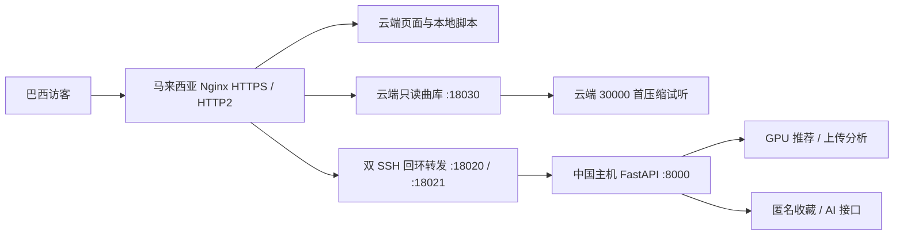

# 巴西展览部署与运行

入口：[resonance.website](https://resonance.website)。目标场景为 20 人以内同时访问，中国主机持续开机、联网并登录 Windows。

## 当前链路



页面、地图边界、曲库检索、歌曲资料和试听由云端直接提供。隧道断开时这些功能仍能使用；推荐、上传分析、收藏同步和 AI 仍需要中国主机。它们不能在本地主机断网期间完成。

云端复用 `/srv/echo/cloud_audio_10gb/` 中已有的 AAC 48 kbps 音频，并已逐条核对当前曲库全部 30,000 个曲目 ID。原始音频和平台歌曲链接保留。20 路连续试听的编码码率合计约 0.96 Mbps，尚未计入协议、地图加载与拖动进度产生的突发流量。

云端只读服务为 `echo-exhibition.service`，仅监听 `127.0.0.1:18030`，无需开放新公网端口。发布目录为 `/srv/echo-exhibition/current`，旧版本保留在 `releases/`。服务使用非 root 用户、只读文件系统保护和 900 MB 内存上限。已有其他网站和防火墙规则未改动。

## 本机监督与恢复

任务 `Echo-Intranet-Web` 使用 `scripts/run_intranet_web.py`。当前专用 SSH 用户为 `echo-tunnel`，密钥位于当前 Windows 用户的 `.ssh/echo_exhibition_ed25519`，不再使用管理员密钥运行网页隧道。

- 两条独立会话分别转发云端回环端口 18020、18021；备用会话使用现有 Tailscale 地址 `100.120.12.57`。主会话失败后也可切换到该地址。
- 两个地址均按 `47.250.196.219` 的已保存主机密钥验证，不自动接受未知主机密钥。
- 专用账号只允许这两个远程回环转发，不允许 shell、SFTP、本地转发、代理转发或其他监听端口；不改变管理员原有登录方式。
- 监督进程每 2 秒检查子进程；失败重连使用带抖动的退避，最高约 60 秒。
- SSH 每 15 秒保活，连续 2 次失败后退出；云端也会清理失效会话。Nginx 可将新请求切到仍存活的备用转发。
- 每 15 秒检查本机健康；持续失败约 90 秒后重启网页进程树。每 30 秒检查公网后台健康；本机正常而公网连续失败 3 次时重建转发。
- 监督进程运行期间使用 Windows 线程电源请求阻止自动睡眠，退出时释放。该机制不能阻止主动关机、系统更新重启或网络故障。
- 后台启动后自动预热推荐模型；预热在后台线程运行，健康接口继续响应。`/api/health` 的 `recommendation_state` 变为 `ready` 后再开始推荐演示。

查看状态：

```powershell
Get-ScheduledTask -TaskName Echo-Intranet-Web
Get-Content tmp\intranet-web\health.json
Get-Content tmp\intranet-web\supervisor.log -Tail 15
Invoke-RestMethod https://resonance.website/api/health
Invoke-RestMethod https://resonance.website/api/edge/health
```

重新启动本机后台：

```powershell
New-Item tmp\intranet-web\stop -ItemType File -Force
while (Test-Path tmp\intranet-web\supervisor.pid) { Start-Sleep -Seconds 1 }
Start-ScheduledTask -TaskName Echo-Intranet-Web
```

更新任务参数时使用 `scripts/install_intranet_web_task.ps1 -Update`。任务在用户登录后启动；当前配置并非无人登录的 Windows 系统服务。

## 并发与安全策略

HTTP/2 与云端文件直出减少重复握手及跨境传输。只读服务先预载元数据字典；字典读取带锁，文件变化检查最多每 0.5 秒一次，减少多人访问时反复解析和磁盘查询。

单 GPU 计算使用 1 个活动槽和最多 24 个等待请求，等待最多 45 秒；过载返回 503 与 `Retry-After: 5`，不会无限堆积。Nginx 最多接纳 32 个计算连接。上传分析放在线程池，避免 FFmpeg、模型推理阻塞健康检查和普通访问。上传文件读取上限为 200 MB，分析最多 60 秒、3 个窗口、20 个结果和 1,500 个召回候选。

公开 API 使用允许清单，模型下载、文件浏览、训练、研究管理、原型和 OpenAPI 入口均不公开。上传试听只允许程序生成的指定媒体路径。收藏会话使用 Secure、HttpOnly、SameSite=Lax Cookie，私人接口响应使用 `no-store`。服务拒绝异常 Host 与跨站写请求，Nginx 覆盖转发来源头以防伪造。

公开 API 按 IP 限制长期平均 40 请求/秒，允许 160 次突发，以容纳展馆共用出口。计算入口长期平均 60 次/分钟、30 次突发；AI 全站长期平均 20 次/分钟、20 次突发，最多 4 个活动请求。公开 AI 仅访问服务器指定的 HTTPS 地址，服务器密钥只能使用指定模型；对话最多 32 条、24,000 字符。API 密钥只留在本机私密配置中，不进入云端公开包。

HTTPS 使用 TLS 1.2/1.3，启用 HSTS、禁止页面嵌套等响应头。Markdown 解析与净化脚本固定版本并放在本地 vendor 目录，取消运行时 CDN 依赖。`web/vendor/exhibition-libraries.json` 保存版本、来源与 SHA-256。现有 SSH Fail2ban 和证书自动续期计时器保持启用。

## 位置显示

优先使用 25,996 首歌曲已有的艺人地点；3,961 首未核实曲目使用平台原始市场地区并标记为 `catalog_market`，使用首都或地区参考点显示。另有 43 首 Jamendo 曲目的平台资料也没有地点，继续显示未知。

平台回退独立保存在 `storage/public/merged/catalog_market_locations.json`，按曲目 ID 关联，不覆盖人工核实信息或原始 CSV。重新生成：

```powershell
.\.venv-gpu\Scripts\python.exe scripts\build_catalog_market_locations.py
.\.venv-gpu\Scripts\python.exe scripts\check_exhibition_locations.py
```

## 发布后续网页与曲库修改

云端现在使用明确的发布快照。只修改中国主机上的网页文件，不会自动更新云端页面。需要重新打包并发布；包只包含公开网页、指定元数据及必要的只读服务模块，排除密钥、上传、用户数据库和模型权重。

```powershell
.\.venv-gpu\Scripts\python.exe scripts\package_exhibition_edge.py --output tmp\exhibition-edge.tar.gz
```

用保留的管理员 SSH 通道将包与 `deploy/exhibition-edge/install_release.py` 上传至服务器，然后执行：

```bash
python3 install_release.py exhibition-edge.tar.gz --sha256 <打包脚本输出的SHA256>
```

安装器核对包哈希和全部音频映射，切换版本并检查服务健康；失败时恢复上一个版本。更改中国主机的 Python 后，还需要重启其监督任务。Nginx 配置修改须先 `nginx -t`，再重载。

本轮初次切换前的 Nginx 配置备份：`/root/echo-deploy-backups/exhibition-20261102T013020Z/`。仅回退 Nginx 时需要同时确认旧上游 18020 是否可用；无需删除新的云端音频或旧项目目录。

## 展览前检查

提前开机、登录并保持供电，确认两个健康接口正常、推荐状态为 `ready`。在展馆实际 Wi-Fi/移动网络上各试一次葡萄牙语界面、试听、推荐、录音上传和收藏；演示时使用 HTTPS 域名。巴西外部探测通过不代表现场网络或跨境链路将始终正常。

本轮测试结果及已知限制见 [2026-11-02 展览自检](../ssh-reverse-tunnel/EXHIBITION_CHECK_2026-11-02_CN.md)。

配置依据：[Nginx 限速](https://nginx.org/en/docs/http/ngx_http_limit_req_module.html)、[代理重试规则](https://nginx.org/en/docs/http/ngx_http_proxy_module.html#proxy_next_upstream)、[OpenSSH PermitListen](https://man.openbsd.org/sshd_config#PermitListen)、[HTTPX HTTP/2](https://www.python-httpx.org/http2/)。
